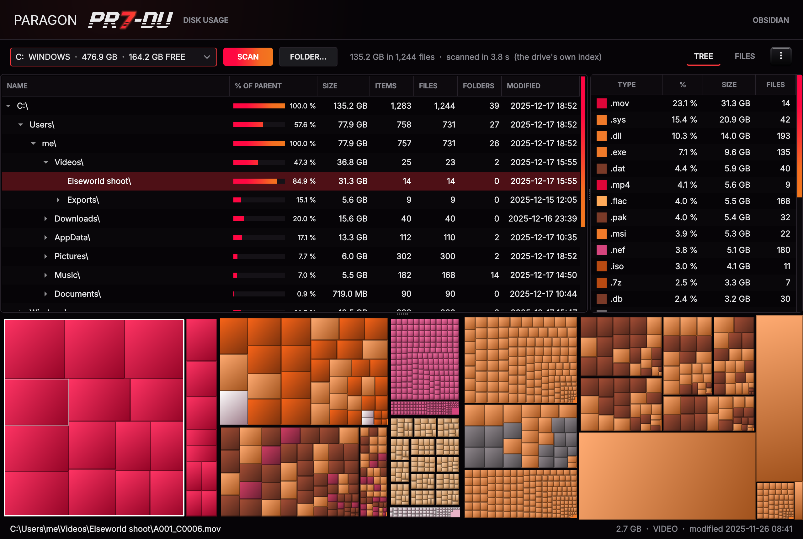

# Paragon PR7-DU

Shows what fills your disks, the way **WizTree** does, in the Paragon family look (PR7-Z, PR7-W, PR7-L, PR7-F,
PR7-E, PR7-R, PR7-P, PR7-M, PR7-Q, PR7-U). Python and PySide6.



## What it does

- **SCAN** a drive (or **FOLDER...** for one folder). With administrator rights, an NTFS drive is read through its own
  index, the Master File Table, as WizTree does: one long read instead of a question per folder. Without them, or on
  other drives, PR7-DU walks the folders. **FASTER AS ADMINISTRATOR** restarts it with the rights (Windows asks).
- **TREE**: every folder with its share of its parent, size, items, files, folders and newest change, largest first.
  **FILES**: the biggest files anywhere on the drive. **Types**: every extension's share.
- **The treemap**: every file a block sized by its size and coloured by its kind (in the family's colours). Point at a
  block to see the file; click it to open the tree down to it; whatever you choose in a list is outlined on the map.
- Right-click anything: Open, Show in folder (PR7-E when it's your folder app), Copy path, Delete to the Recycle Bin
  (every folder above gets smaller at once, no rescan). F5 rescans.
- Junctions and symbolic links aren't followed (they'd count the same space twice), as WizTree does.

## Command line

```
PR7-DU.exe [folder or drive]           scan it (in the running PR7-DU if there is one)
PR7-DU.exe --selftest FOLDER OUT.json  the install check CI runs
```

## Building

`pip install -r requirements-dev.txt`, `python -m pytest` (the MFT tests need `mkntfs` and `ntfs-3g` on Linux),
`pyinstaller pr7du.spec`, then Inno Setup 6 on `installer/pr7du.iss`. CI does all of it on Windows; a pushed new version
publishes itself.
